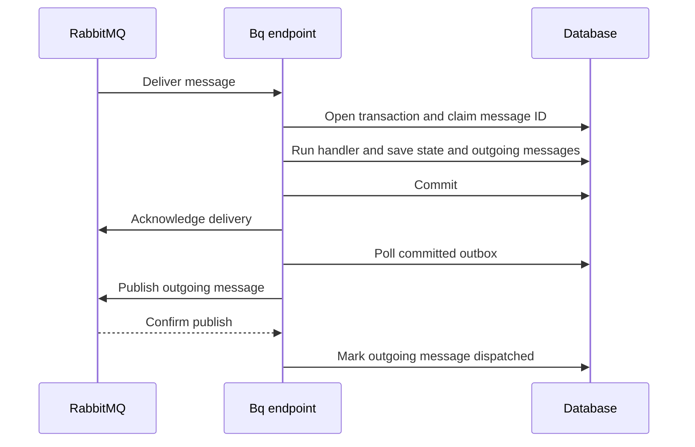

# Delivery architecture

A Bq endpoint consumes from its RabbitMQ input queue. Its persistence provider coordinates database work. RabbitMQ and the database commit independently, so Bq uses stable message IDs to deal with redelivery.

All registered handlers for a delivery share a persistence session. Writes using the session's connection and transaction commit with the inbox claim and outgoing messages. A delivery whose message ID has already committed skips the handlers. Direct sends made through the endpoint publish immediately and sit outside this transaction.

## Where failures are handled

| Failure point | Result |
| --- | --- |
| A handler throws before commit | Bq rolls back the attempt. An immediate retry opens a new transaction and deserializes the message again. |
| Immediate retries are exhausted | Bq stores a delayed retry or final error in a separate transaction before acknowledging the original delivery. If that handoff fails, Bq requests redelivery. |
| The database commits and the acknowledgment is lost | RabbitMQ can redeliver. The inbox or the recorded recovery decision suppresses committed work. |
| The broker accepts an outgoing message but the confirmation or dispatch bookkeeping fails | Bq can publish the same message again with its original ID. Consumers need deduplication or idempotency. |

## Dispatch workers

The endpoint polls recovery records separately from ordinary outgoing messages. SQLite alternates preference between ordinary outbox messages and due saga timeouts. A failed recovery destination can hold up other recovery records. An unroutable outbox message can hold up later records in its own category.

With several processes on one endpoint, extra processes add failover and polling load, not publishing speed. See [many processes on one endpoint](persistence.md#many-processes-on-one-endpoint).

See [persistence and outbox](persistence.md) for backlog inspection and [retries and replay](recoverability.md) for recovering failed messages.
