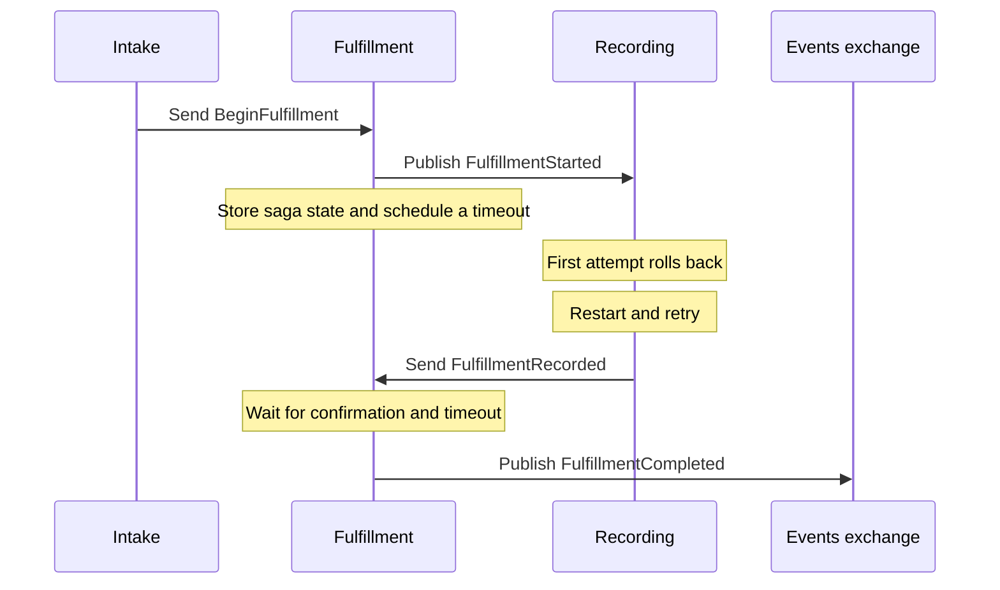

# An order workflow with Bq

Suppose a shop needs to accept an order, start fulfillment, and record the work. Those steps can finish at different times. If the recording service is temporarily unavailable, the shop should still be able to accept the order and finish it later.

Bq connects these steps with messages. Each **endpoint** owns its application data and Bq tables in one database. A receiving endpoint listens on a RabbitMQ queue and calls a **handler** when a message arrives. The example uses three endpoints and separate SQLite databases.



## 1. Accept the order

Intake saves the order and sends `BeginFulfillment` to the fulfillment endpoint. A **command** asks a specific endpoint to do something. Intake is send-only, so it has no incoming queue.

Intake writes the order and the outgoing command in the same database transaction. The **outbox** is the table that holds the command until Bq can publish it. If the transaction rolls back, neither write survives. If it commits while RabbitMQ is unavailable, the command stays in the outbox for the dispatcher to send later. Intake can return after the commit while fulfillment continues in the background.

## 2. Start fulfillment and remember its progress

Fulfillment starts a **saga** for the order. A saga stores the progress of work that spans several messages. Bq uses the order ID to find the same saga when subsequent messages arrive.

The saga publishes `FulfillmentStarted`. An **event** announces something that already happened. Interested endpoints subscribe to it, and RabbitMQ routes a copy to each subscription. In this example, Recording subscribes.

The saga also schedules a durable timeout. This example requires both a recording confirmation and a timeout before it completes. Either can arrive first, and the saga remembers which one it has seen. The timeout is a scheduled message, so its due time survives an endpoint restart.

## 3. Roll back, retry, and finish

Recording saves its own business row and sends the `FulfillmentRecorded` command back to fulfillment. The test forces the first attempt to fail after both writes. Bq rolls back the row and the outgoing confirmation, then durably schedules a retry. The test stops Recording after that retry has been stored and starts a new instance using the same database.

The retried handler commits the business row and confirmation. Once the saga has both the confirmation and the timeout, it publishes `FulfillmentCompleted` and removes its saved state.

RabbitMQ can deliver a message more than once. Bq’s **inbox** records successfully processed message IDs in the same transaction as the handler’s writes. The test redelivers the original event and its retry with the same identity and checks that Recording still has one business row and fulfillment publishes no extra completion event.

## Run the example

Run the workflow as part of the local integration suite. Look for `Cross-endpoint order workflow and restart test passed.`

```sh
bash scripts/test-rabbitmq.sh
```

The runner needs the .NET SDK, Mono, and Podman. To write your first endpoint, follow [Getting started](getting-started.md). For the runner and transport-free testing options, see [Integration tests](testing.md).
